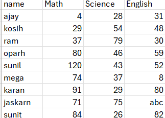

# Student Marks Data Processor

A small ETL pipeline in Python that reads student marks from a CSV file,
validates them, calculates totals and percentages, and separates clean
data from rejected rows.

## What it does
- **Extract:** reads students.csv using csv.DictReader
- **Transform:** validates each mark (missing, not numeric, out of range),
  calculates total and percentage
- **Load:** writes valid rows to output.csv and invalid rows to rejected.csv
  with the reason
- **Observe:** logs every problem and final counts to pipeline.log

## Validation rules
| Check | Rule | Reason recorded |
|---|---|---|
| Missing | Empty or only spaces | missing |
| Not numeric | float() raises ValueError | not a number |
| Out of range | Below 0 or above 100 | out of range |

## How to run
python pipleline.py

## Sample input
name,Math,Science,English
ajay,4,28,31
kosih,29,54,48
ram,37,79,30
oparh,80,46,59
sunil,120,43,52
mega,74,37,8
karan,91,29,80
jaskarn,71,75,abc
sunit,84,26,82

## Screenshots

## Design decisions
Invalid rows are kept in rejected.csv rather than deleted, so bad data
can be reviewed and fixed at the source.

## What I learned
File handling, CSV processing, error handling, logging, and structuring
code into small single-purpose functions.

## Possible improvements
- Accept file paths via command-line arguments
- Add unit tests with pytest
- Support more subjects through a config file